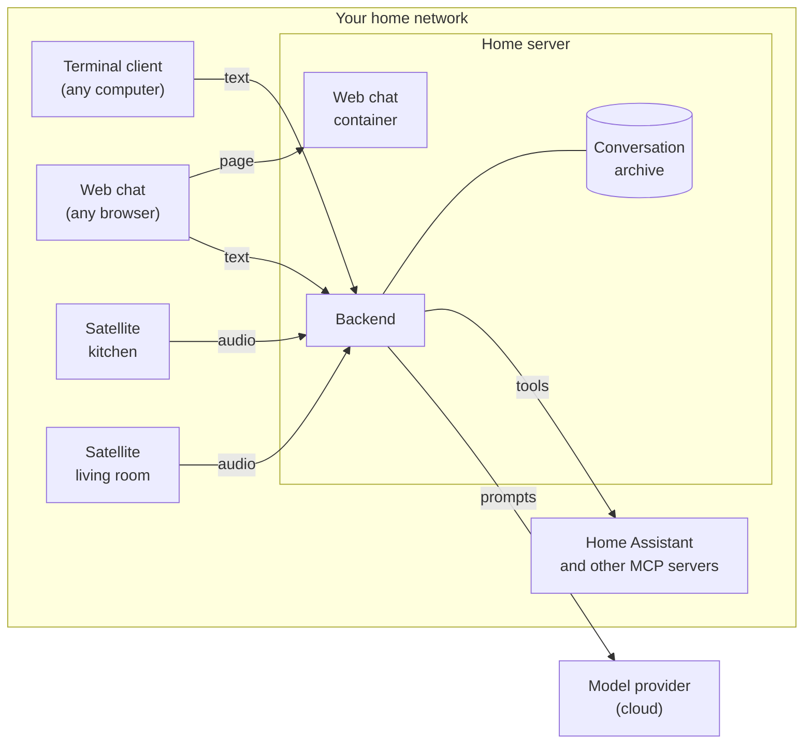

Ambrogio has one server and any number of clients. The server, called the backend, does the work that needs memory and computing power: storing conversations, asking AI models for answers, recognising speech and speaking. The clients only get your words to the backend and bring the answer back to you.

## The programs

**The backend** (`ambrogio-backend`) runs on a machine that is always on, such as a home server or a NAS with Docker. Inside it:

- the *conversation archive*, a SQLite file with every conversation;
- the *agents*: an orchestrator that picks who answers, and specialised agents that answer, each with its own instructions and model;
- *speech recognition* while you speak, with a streaming transducer model such as Nemotron, and *speech synthesis* with Piper voices or a Kokoro model, both run by sherpa-onnx inside the backend process, without any cloud speech service;
- the *public interface*: two HTTP endpoints for reading conversations and a WebSocket session for talking.

**The terminal client** (`ambrogio-cli`) is a chat window for a terminal. It sends and receives text.

**The web chat** (`ambrogio-web`) is the same kind of chat in a browser. An optional container serves the page; the page then talks to the backend directly, so the backend must list the page's address in `allowedOrigins`. Answers are shown as Markdown, and the interface is in Italian or English.

**The voice satellite** (`ambrogio-satellite`) is a program for a small device with a microphone and a speaker. It listens for a wake word on the device, with sherpa-onnx keyword spotting and speech detection, records your request, sends the audio to the backend and plays the answer. It does not recognise speech or generate voices itself.

The only part outside your home is the language model. Agents send the conversation to their provider's API, such as Mistral, OpenAI, Anthropic or Google, to get answers. With an OpenAI-compatible model server on your own network, nothing leaves it. Everything else, including the audio, stays on your network.

## One protocol for everything

All clients talk to the backend in the same way, over a WebSocket session with the `ambrogio.v1` protocol. A turn is sent as text or as audio, and the client says whether it wants the answer as text or as audio. The terminal client and the web chat send text and ask for text; the satellite sends audio and asks for audio. The backend applies the same rules to both: the same limits, the same refusals, the same outcomes.

This has a practical consequence: a conversation does not belong to a client. A conversation started out loud in the kitchen is stored as text, and you can open it in the terminal or in the browser and continue it by typing. The [conversation protocol reference](../../reference/conversation-protocol/) has the details.

## Why separate repositories

The programs run on different machines, have different dependencies and change at different speeds. The satellite needs audio libraries and runs on ARM boards; the backend needs speech models and runs on a server; the terminal client and the web chat need neither. The web chat is optional too: if you do not want it, you do not install its container. Keeping them apart means a satellite update does not force you to touch the server, and the other way round.

What holds them together is the protocol. The backend owns it and the HTTP API; clients use only those public interfaces, and an incompatible change gets a new interface version. [Versions and compatibility](../../reference/versions/) explains how to read that.

## How configuration works

The backend and the satellite are configured the way containers usually are: with environment variables. The code that reads and checks them is part of each program, one module per configurable part, so you set values and never run code of your own. Each program reads its configuration once, when it starts, and refuses to start if a value is missing or wrong, naming the variable but never its value, so a mistake cannot pass silently and a secret cannot end up in a log.

Agent definitions are the one exception: an agent has long instructions and nested settings that do not fit well in variables, so each agent is a JSON file of plain data mounted into the backend. Secrets stay out of those files too. A file only names the variable that holds a key or token, so agent files can be copied, shared and kept in Git safely.

Every process also declares its environment, `development`, `test` or `production`, in `AMBROGIO_ENV`. Some conveniences, such as listening on `127.0.0.1:3000` without being told, exist only in development, so a production installation never runs on a value nobody chose. Every default has one owner: the program applies it, and the example files do not repeat it, so changing a default in a new release cannot be undone by an old example. See [Backend configuration](../../reference/backend-configuration/) and [Satellite configuration](../../reference/satellite-configuration/).

## How the code is organised

Ambrogio is built model-first with [Reqvire](https://reqvire.org/): capabilities, requirements, contracts and verifications are written before the code changes. They form one model spread over the repositories: each repository keeps its part in `system-model/`, and [`ambrogio-model`](https://github.com/ambrogio-app/ambrogio-model) holds the product capabilities, the shared vocabulary and the rules common to all repositories. When this documentation states a limit or a default, it comes from those contracts. If you want to know *why* something behaves as it does, the decisions and their reasons are recorded there; their history is in Git.

Inside, the code follows a ports-and-adapters design: the rules of conversations and turns do not depend on Node.js, SQLite, the model providers or the audio libraries, which are plugged in at the edges. The web chat is organised by feature instead, and each feature keeps its logic apart from its React components, so the protocol handling is tested without a browser.

## Further reading

- [Turns and outcomes](../turns/): what happens to a request from start to finish.
- [Agents and the orchestrator](../agents/): how an answer is produced.
- [How voice works](../voice/): the path from your voice to Ambrogio's.
- [Security and privacy](../security/): what the design protects and what it leaves to you.
