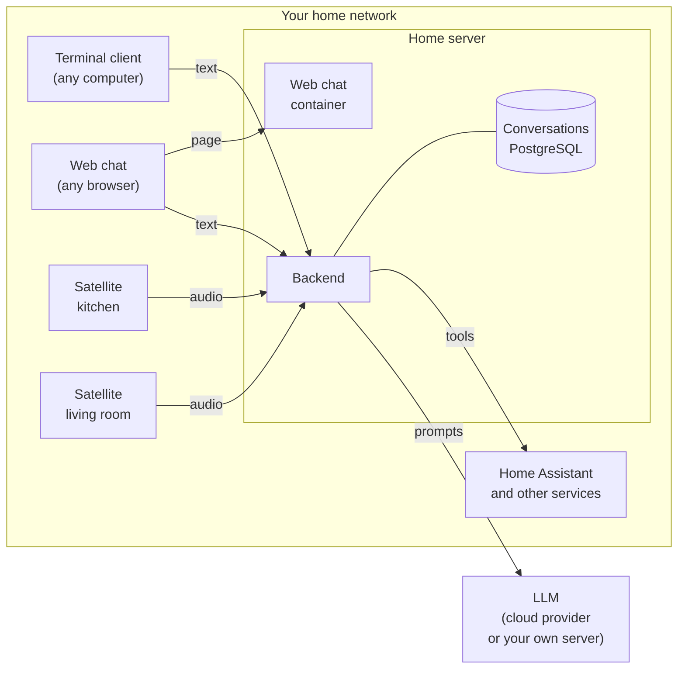

Ambrogio has one server, the backend, and any number of clients. The backend does the work: it stores conversations, asks the LLMs for answers, recognises speech and speaks. The clients carry your words to the backend and the answer back to you.

## Any client, any conversation

All clients talk to the backend in the same way. The terminal client and the web chat send text; a satellite sends your voice and gets a spoken answer. The backend stores every conversation as text, with the same rules whatever the client.

So a conversation does not belong to a client. A question asked out loud in the kitchen can be opened in the browser and continued by typing.

## The pieces on your server

- **The backend** runs on a machine that is always on, such as a home server or a NAS.
- **The database** keeps the conversations. It runs beside the backend as a second container.
- **The web chat**, if you want it, is a third container that serves the chat page. Once the page is open in a browser, it talks to the backend directly, which is why the backend must allow the page's address.

The satellites run on their own devices, one per room, and the terminal client on any computer. Each program is released separately; [Versions and compatibility](../../reference/versions/) says which releases work together.

## How you configure it

- **The backend and the satellite** read their settings from environment variables, once, when they start. A missing or wrong value stops the program with a message that names the variable, never its value, so a mistake cannot pass unnoticed and a secret cannot end up in a log.
- **Agents** are JSON files, one per agent, read by the backend when it starts.
- **The web chat** reads `config.json`, which tells the page where the backend is.
- **The terminal client** takes the backend's address when you start it.
- **Secrets**, such as API keys and tokens, live only in environment variables. Agent files only name the variable, so you can copy and share them safely.

After changing a setting or an agent file, restart the program.

## What stays at home

Everything runs on your network, except the LLMs if you use a cloud provider, and the services you connect outside your home. [Security and privacy](../security/#what-leaves-your-home) lists what leaves.
