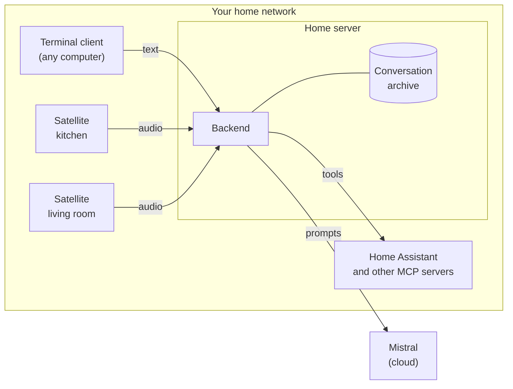

Ambrogio has one server and any number of clients. The server, called the backend, does the work that needs memory and computing power: storing conversations, asking AI models for answers, recognising speech and speaking. The clients only get your words to the backend and bring the answer back to you.

## The three programs

**The backend** (`ambrogio-backend`) runs on a machine that is always on, such as a home server or a NAS with Docker. Inside it:

- the *conversation archive*, a SQLite file with every conversation;
- the *agents*: an orchestrator that picks who answers, and specialised agents that answer, each with its own instructions and model;
- *speech recognition* with Vosk and *speech synthesis* with Piper voices, both running inside the backend process, without any cloud speech service;
- the *public interface*: two HTTP endpoints for reading conversations and a WebSocket session for talking.

**The terminal client** (`ambrogio-cli`) is a chat window for a terminal. It sends and receives text.

**The voice satellite** (`ambrogio-satellite`) is a program for a small device with a microphone and a speaker. It listens for a wake word on the device, records your request, sends the audio to the backend and plays the answer. It does not recognise speech or generate voices itself.

The only part outside your home is the language model. Agents send the conversation to Mistral's API to get answers. Everything else, including the audio, stays on your network.

## One protocol for everything

Both clients talk to the backend in the same way, over a WebSocket session with the `ambrogio.v1` protocol. A turn is sent as text or as audio, and the client says whether it wants the answer as text or as audio. The terminal client sends text and asks for text; the satellite sends audio and asks for audio. The backend applies the same rules to both: the same limits, the same refusals, the same outcomes.

This has a practical consequence: a conversation does not belong to a client. A conversation started out loud in the kitchen is stored as text, and you can open it in the terminal and continue it by typing. The [conversation protocol reference](/reference/conversation-protocol/) has the details.

## Why three repositories

The programs run on different machines, have different dependencies and change at different speeds. The satellite needs audio libraries and runs on ARM boards; the backend needs speech models and runs on a server; the terminal client needs neither. Keeping them apart means a satellite update does not force you to touch the server, and the other way round.

What holds them together is the protocol. The backend owns it, and each client records which backend revision it has been tested against. [Versions and compatibility](/reference/versions/) explains how to read that.

## How the code is organised

Each repository is built model-first with [Reqvire](https://reqvire.org/): capabilities, requirements, contracts and verifications are written in `system-model/` before the code changes. When this documentation states a limit or a default, it comes from those contracts. If you want to know *why* something behaves as it does, the decisions are recorded there, with dates and the alternatives that were considered.

Inside, the code follows a ports-and-adapters design: the rules of conversations and turns do not depend on Node.js, SQLite, Mistral or the audio libraries, which are plugged in at the edges.

## Further reading

- [Turns and outcomes](/explanation/turns/): what happens to a request from start to finish.
- [Agents and the orchestrator](/explanation/agents/): how an answer is produced.
- [How voice works](/explanation/voice/): the path from your voice to Ambrogio's.
- [Security and privacy](/explanation/security/): what the design protects and what it leaves to you.
