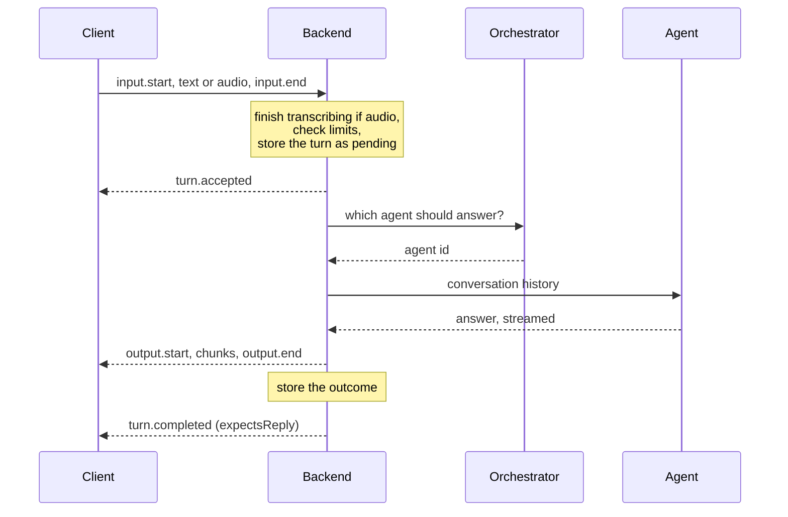

A *turn* is one request from the family: a typed message or a spoken question. A *conversation* is a sequence of turns, each with its outcome. Understanding the life of a turn explains most of what you see in the clients, including the occasional "interrupted" or "another turn is in progress".

## From request to answer

The key moment is **acceptance**. Before it, the backend can still refuse the turn: the text is empty, the audio is too long, the speech was not understood, the conversation is busy. A refused turn leaves no trace in the history.

Once the turn is accepted, it is written to the archive as *pending*, and from then on it will always end with a stored outcome: answered, failed or interrupted. The client receives `turn.accepted` with the identifiers of the conversation and the turn, and for a spoken turn the transcribed text.

## One turn at a time per conversation

A conversation can only work on one turn at a time. If you type in the terminal while the same conversation is still answering, the new turn is refused as *occupied*. It is not queued for later.

Different conversations do not wait for each other. Two satellites in two rooms each start their own conversation, and their turns run in parallel.

The rule exists because each answer depends on the whole history. If two turns of the same conversation ran together, each would be answered without knowing about the other.

## The answer streams, the outcome confirms

The answer reaches the client a piece at a time while the agent is still writing it. That is why text appears gradually in the terminal and why a satellite starts speaking before the whole answer is ready.

Streaming text is not proof of success. Only `turn.completed` means the answer was stored. If something breaks halfway, the backend closes the partial answer and sends the standard error message in a new stream, and the turn is stored as *failed* with that message, not with the partial answer.

## When the client disconnects

Leaving does not cancel a turn. If the terminal closes or the Wi-Fi drops after acceptance, the backend finishes the answer and stores it anyway. Messages that could not be delivered are not resent when the client reconnects; the client reads the outcome from the history instead.

That is why the terminal client sometimes shows a turn as *in elaborazione* when you open a conversation: the answer is still being produced. Refresh later and it appears.

## When the server stops

Stopping or restarting the backend does not wait for answers in progress. Every turn that has not yet been answered is stored as *interrupted*, and the clients that are still connected receive `turn.interrupted`. If the process dies before it can do this, for example in a power cut, the next startup finds the pending turns and marks them as interrupted.

Interrupted turns are not retried. Repeat the question if you still need the answer.

After saving the interrupted turns, the backend closes its resources in the reverse order it opened them: the listener, the voice components, the archive and the MCP connections. It gives itself 10 seconds for the whole shutdown. If something does not close in time, it logs `server_shutdown_timeout` and exits anyway with code `1`, so a stuck connection cannot keep it running. Docker must wait longer than that before it kills the container, which is why the Compose example sets `stop_grace_period: 15s`.

## Time limits

An answer must be complete within 30 seconds, counting the orchestrator's choice, the agent's answer and any tool calls. This prevents a stalled request to the model from keeping a conversation busy forever. A turn that hits the limit fails with the standard message.

## Expecting a reply

Each completed turn carries `expectsReply`: whether the answer asks the family something. The agent decides this together with the answer. The satellite uses it to listen again without the wake word; the terminal client ignores it, because you can always type. Failed, refused and interrupted turns never expect a reply.

## One identity for the family

Ambrogio has no user accounts. Everyone in the home shares one identity, *the family*, and everyone sees every conversation from any client. The `clientId` that clients send only identifies the connection, not the person.
