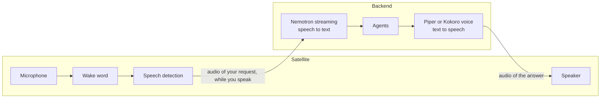

Voice work is split between the satellite and the backend. The satellite decides *when* you are talking to Ambrogio. The backend works out *what* you said and how to say the answer.

## On the satellite

**The wake word.** The microphone is always open, but the audio goes only to a small keyword spotting model running on the device. Nothing is sent anywhere until it hears "Alexa" or the word you chose. The satellite never writes audio to disk.

The wake word is plain text, not a model trained for one word. The satellite splits it into the pieces of the model's vocabulary, and the keyword spotter listens for that sequence. You can pick any word without training anything. The price is accuracy: the bundled model learned from English speech, so English-sounding words work best, and how often a word is missed or heard by mistake depends on the word, the model and the threshold you choose.

**Checking that someone spoke.** The same audio also goes to the speech detector. A detection counts only if the detector heard speech in the last second and a half; otherwise the satellite discards it and logs `satellite_wake_rejected`. This filters out noises that the keyword spotter mistakes for the word.

**The beep.** After the wake word, the satellite makes sure its session with the backend is ready, then plays a short beep. The beep is a promise: from this moment the backend can receive what you say. If the backend is unreachable you hear a warning instead of the beep.

**Speech detection.** The speech detector, the Silero VAD model, also finds the start and end of your request. The satellite starts sending only once it is confident you are speaking, and stops when you have been silent for about two-thirds of a second. That pause is what ends your request; there is no button.

**Saying it in one breath.** The satellite keeps the last second and a half of audio in memory. When you say *"Alexa, what's the weather like?"* without stopping, the start of the question was spoken before the beep; that buffer means it is not lost.

## On the backend

**Recognition while you speak.** The backend passes each piece of your audio to the speech recognition model as soon as it arrives, so the text is built up while you are still talking. When the satellite says you have finished, the backend adds 0.8 seconds of silence, which lets the model finish your last words, and decodes only that final part. The wait after you stop is therefore about the same for a short question and a long one. Recognition runs in a separate worker thread with up to two CPU threads, so it does not hold up the rest of the backend; requests from several satellites share it and their audio is processed in the order it arrives. The transcription becomes the text of the turn, exactly as if you had typed it. If it comes out empty, or recognition fails, the turn is refused with "I didn't understand the request." If the worker itself stops because of a fault, the next voice request starts a new one.

**Why a streaming model.** The bundled model, Nemotron 3.5 ASR streaming 0.6B by NVIDIA, reads audio in chunks of 560 ms and recognises by itself whether you spoke Italian or English, so one model serves both languages. Offline models such as Parakeet TDT and Whisper, which reached a similar accuracy on Italian, decode only after you stop, so the wait would grow with the length of the request. Ambrogio supports one family, sherpa-onnx streaming transducers, to keep a single code path: another model of the same family is a matter of pointing to a different folder, another family needs a change to the code.

**The hardware it needs.** Recognising speech as fast as you speak needs an x86_64 CPU with AVX2 instructions. On a CPU without AVX2, such as a low-end Celeron, recognition falls behind: the audio waits, nothing is lost, but the text arrives after the end of the sentence, and the longer you speak the longer the wait.

**Speaking while it thinks.** The answer is spoken a sentence at a time, as soon as each sentence is complete, instead of waiting for the whole text. Before speaking, the backend strips Markdown symbols such as asterisks, link addresses and table bars, so the voice does not read them out. The stored text keeps its formatting.

**One voice for the house.** The backend loads one voice at startup. All satellites speak with it. When several satellites are answering at once, their sentences are synthesised one after another, because the voice engine handles one sentence at a time.

**Two kinds of voice.** The backend speaks with [sherpa-onnx](https://github.com/k2-fsa/sherpa-onnx), which runs either a Piper voice or a Kokoro model inside the backend process. The image includes Italian and English Piper voices and one multilingual Kokoro model. It also includes one multilingual Nemotron model for recognition in both languages. `AMBROGIO_LANGUAGE` selects the matching voice profile, whose paths can point to bundled or mounted models. The example configuration chooses Piper because it runs fast enough on a low-power mini PC. Kokoro sounds more natural but needs several times more computing power: on a 4-core Celeron N5095 it is slower than speech itself, so answers would start late and stop between sentences. Both use espeak-ng to turn text into sounds in the language of the voice.

**One speech engine.** The satellite and the backend run all their speech models with [sherpa-onnx](https://github.com/k2-fsa/sherpa-onnx): wake word, speech detection, recognition and synthesis. One engine means fewer native libraries, smaller images and fewer combinations to test. A model of a family that Ambrogio supports can be swapped with files and configuration alone; a new family needs a change to the code.

## Follow-up replies

When an answer asks you something, the agent marks it as expecting a reply. After the satellite has played the whole answer, it beeps and listens again in the same conversation, without the wake word. If you do not start speaking within 15 seconds (configurable with `AMBROGIO_REPLY_TIMEOUT_MS`), it goes back to waiting for the wake word.

Each wake word starts a new conversation. A follow-up reply is the only way a satellite continues an existing one. To continue an older conversation, use the terminal client.

While the satellite is speaking, it does not listen. You cannot interrupt an answer.

## When something goes wrong

The satellite always ends an interaction by going back to the wake word. If the backend cannot be reached, the session drops, or no outcome arrives within 60 seconds, it plays a short error tone, two descending notes, and waits for the next wake word. It never resends a request by itself.

If the backend has no voice configured, it answers in text, and the satellite plays the same error tone instead. A tone works whatever language and voice you choose; the log, or the same conversation in the web chat or the terminal client, tells you what went wrong.

## Privacy

- No audio leaves the satellite before the wake word.
- Audio reaches the backend only after the beep and only until the end of your request.
- Neither the satellite nor the backend stores audio. Conversations are stored as text.
- Recognition and synthesis run on your server. Only the transcribed text goes to the language model in the cloud.
