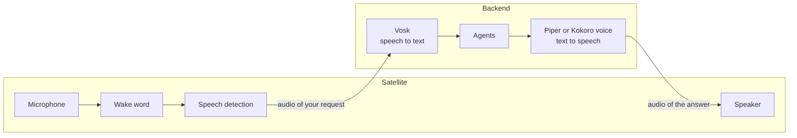

Voice work is split between the satellite and the backend. The satellite decides *when* you are talking to Ambrogio. The backend works out *what* you said and how to say the answer.

## On the satellite

**The wake word.** The microphone is always open, but the audio goes only to a small wake word model running on the device. Nothing is sent anywhere until it hears "Hey Jarvis" (or the word you chose). The satellite never writes audio to disk.

**The beep.** After the wake word, the satellite makes sure its session with the backend is ready, then plays a short beep. The beep is a promise: from this moment the backend can receive what you say. If the backend is unreachable you hear a warning instead of the beep.

**Speech detection.** A second model, Silero VAD, listens for the start and end of your speech. The satellite starts sending only once it is confident you are speaking, and stops when you have been silent for about two-thirds of a second. That pause is what ends your request; there is no button.

**Saying it in one breath.** The satellite keeps the last second and a half of audio in memory. When you say *"Hey Jarvis, che tempo fa?"* without stopping, the start of the question was spoken before the beep; that buffer means it is not lost.

## On the backend

**Recognition while you speak.** The backend passes your audio to Vosk as it arrives, so that when you stop, only the last bit is left to transcribe. The transcription becomes the text of the turn, exactly as if you had typed it. If it comes out empty, the turn is refused with *"Non ho capito la richiesta."*

**Speaking while it thinks.** The answer is spoken a sentence at a time, as soon as each sentence is complete, instead of waiting for the whole text. Before speaking, the backend strips Markdown symbols such as asterisks, link addresses and table bars, so the voice does not read them out. The stored text keeps its formatting.

**One voice for the house.** The backend loads one voice at startup. All satellites speak with it. When several satellites are answering at once, their sentences are synthesised one after another, because the voice engine handles one sentence at a time.

**Two kinds of voice.** The backend speaks with [sherpa-onnx](https://github.com/k2-fsa/sherpa-onnx), which runs either a Piper voice or a Kokoro model inside the backend process. The Piper voices are small and fast enough for a low-power mini PC, so two of them ship in the image. Kokoro sounds more natural but needs several times more computing power: on a 4-core Celeron N5095 it is slower than speech itself, so answers would start late and stop between sentences. That is why it is an option you download and enable, not the default. Both use espeak-ng to turn text into sounds in the language of the voice, so they pronounce names and numbers in a similar way; they differ in voice and intonation. Ambrogio does not choose the language: a Piper voice is made for one language, and a Kokoro model reads in the `voiceLanguage` you set.

## Follow-up replies

When an answer asks you something, the agent marks it as expecting a reply. After the satellite has played the whole answer, it beeps and listens again in the same conversation, without the wake word. If you do not start speaking within 15 seconds (configurable with `replyTimeoutMs`), it goes back to waiting for the wake word.

Each wake word starts a new conversation. A follow-up reply is the only way a satellite continues an existing one. To continue an older conversation, use the terminal client.

While the satellite is speaking, it does not listen. You cannot interrupt an answer.

## When something goes wrong

The satellite always ends an interaction by going back to the wake word. If the backend cannot be reached, the session drops, or no outcome arrives within 60 seconds, it plays a short error tone, two descending notes, and waits for the next wake word. It never resends a request by itself.

If the backend has no voice configured, it answers in text, and the satellite plays the same error tone instead. A tone works whatever language and voice you choose; the log, or the same conversation in the web chat or the terminal client, tells you what went wrong.

## Privacy

- No audio leaves the satellite before the wake word.
- Audio reaches the backend only after the beep and only until the end of your request.
- Neither the satellite nor the backend stores audio. Conversations are stored as text.
- Recognition and synthesis run on your server. Only the transcribed text goes to the language model in the cloud.
