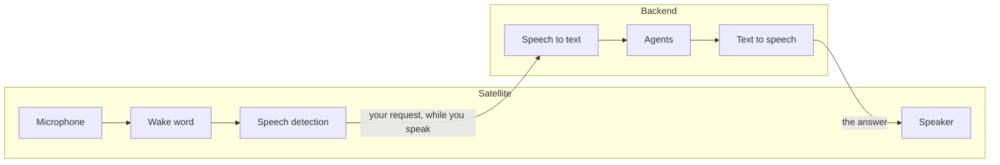

Voice is split between the satellite and the backend. The satellite decides *when* you are talking to Ambrogio. The backend works out *what* you said and speaks the answer.

## On the satellite

**The wake word.** The microphone is always open, but the audio stays on the device until the satellite hears "Alexa", or the word you chose. The word is plain text: you can pick any word without training anything. Words that sound English work best, and how often a word is missed or heard by mistake depends on the word and on the threshold you set.

**Ignoring noises.** A detection counts only if the satellite also heard someone speaking. A noise that sounds like the word is ignored.

**The beep.** After the wake word, the satellite connects to the backend and plays a short beep. The beep means: speak now, the backend is listening. If the backend cannot be reached, you hear an error tone instead.

**The end of your request.** There is no button: a short pause, about two-thirds of a second, ends your request. If you say *"Alexa, what's the weather like?"* in one breath, nothing is lost: the satellite keeps the last moment before the beep.

## On the backend

**Recognition while you speak.** The backend turns your speech into text while you are still talking, so the wait after you stop is about the same for a short question and a long one. The text becomes the message of the turn, exactly as if you had typed it. If nothing could be understood, the request is refused with "I didn't understand the request."

**Speaking while it thinks.** The answer is spoken one sentence at a time, as soon as each sentence is ready. Formatting such as asterisks and link addresses is not read out; the stored text keeps it.

**One voice for the house.** All satellites speak with the same voice, the one set for the backend's language, Italian or English.

## Follow-up replies

When an answer asks you something, the satellite beeps after the answer and listens again in the same conversation, without the wake word. If you do not start speaking within 15 seconds, or the time you set, it goes back to waiting for the wake word.

Each wake word starts a new conversation; a follow-up reply is the only way a satellite continues one. To continue an older conversation, use the web chat or the terminal client.

While the satellite is speaking it does not listen: you cannot interrupt an answer.

## When something goes wrong

If the backend cannot be reached, the connection drops, or no answer arrives within 60 seconds, the satellite plays two descending tones and waits for the next wake word. It never repeats a request by itself. The log, or the same conversation in the web chat, tells you what went wrong.

## Privacy

- No audio leaves the satellite before the wake word.
- Audio reaches the backend only after the beep and only until the end of your request.
- Neither the satellite nor the backend stores audio: conversations are stored as text.
- Recognition and speech run on your server. Only the text goes to the LLM, which is outside your home only if you use a cloud provider.
